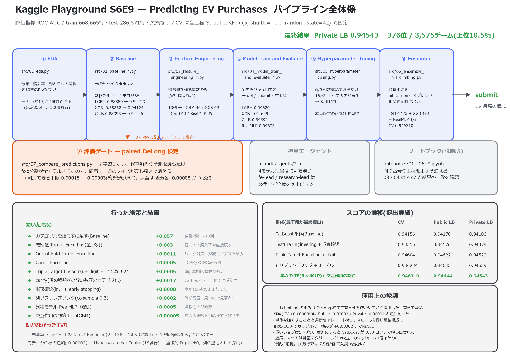

# Kaggle Playground Series S6E9 — Predicting Electric Vehicle Purchases

## コンペ概要

EV(電気自動車)を購入するか(`Will_Buy_EV`: Yes/No)を予測する二値分類コンペ。
評価指標は **ROC-AUC(0~1)**。 ※ 1 に近いほど精度がよく、順位が高い。

- コンペ: https://www.kaggle.com/competitions/playground-series-s6e9
- 開催: Kaggle 主催の Playground Series
- 期間: 2026-09-01〜09-30 の 1 か月
- 参加: 3,575チーム
- データ: 顧客の属性・通勤距離・充電環境・補助金の有無など 13 列。train.csv(学習用データ) 668,665 行 / test.csv(テスト用データ) 286,571 行。
- 提出: kaggle 側より提供された`train.csv`,`test.csv`よりモデルを作成し、EV(電気自動車)を購入するか(`Will_Buy_EV`: Yes/No)を予測した`submission.csv`を作成し、提出する。
- 評価基準: `submission.csv`を提出し、コンペ終了後にスコア(`ROC-AUC(0~1)`)および順位が公開される。

## 結果

**最終結果: Private LB 0.94543、376位 / 3,575チーム(上位10.5%)**

| 構成 | CV | Public LB | Private LB |
|---|---|---|---|
| LightGBM・XGBoost・RealMLP のアンサンブル | 0.946310 | 0.94644 | **0.94543** |

**参考**
- CV: 自作のモデル内でスコアチェックする参考指標
- Public LB: 提出のたびに表示される参考指標（正解データの一部(test の 20%)で採点した結果）
- Private LB: コンペ終了後に公開される最終スコア（残りの test の 80% で採点。このスコアを元に最終順位が決定）

## スコアの推移（詳細は各工程にて説明）

| 提出 | 主な施策(工程) | CV | Private LB | Private の順位 |
|---|---|---|---|---|
| 1 | 元のデータの列だけで学習した基準のモデル(②) | 0.94156 | 0.94106 | 約2,300位(上位64%) |
| 2 | 「値ごとの購入率」と「値ごとの人数」を特徴量に追加(③)。木の本数を増やし、学習しきるようにした(⑤) | 0.94555 | 0.94479 | 約1,380位(39%) |
| 3 | 購入率の特徴量を補強(③) | 0.94604 | 0.94529 | 約950位(27%) |
| 4 | 1本の木が見る列を絞った(⑤)。仕組みの違うモデルを加え、3モデルの予測を混ぜた(⑥) | 0.946234 | 0.94539 | 約640位(18%) |
| 5 | 重複した列を整理し、特徴量を少し追加(③) | 0.946264 | 0.94540 | 約590位(17%) |
| **6** | **年収の列とほかの列を、別々の枝で学ばせた(⑤)= 最終提出** | **0.946310** | **0.94543** | **376位(10.5%)** |

- 改善の大半は特徴量エンジニアリングによるもの(③、+0.004)。ただし、列どうしを足し引きしたり組み合わせたりした特徴量は、ほとんど効かなかった
- CV が上がった順に Private も上がった。各施策を採用するかは ⑦ の検定で判断した。施策の詳細は各工程の節を参照

## プロセス全体像



---

## ソースコード・Notebooks

`src/` が本番用の`.py`ファイル、`notebooks/` は同じ番号の工程を上から追う説明用`.ipynb`ファイル。
詳しい説明と結果は各ノートブックを参照。
各ファイルの先頭に下記の表と対になる連番を記載。

| # | 工程 | 役割詳細 | ファイル名(`src/` は `.py`、`notebooks/` は `.ipynb`) | 出力 |
|---|---|---|---|---|
| ① | EDA(探索的データ分析) | データ・値の種類、各説明変数ごとの購入率を調べ、特徴量の仮説を立てる工程 | `01_eda` | `datacheck/*.png` |
| ② | Baseline(ベースライン) | 元のデータ列(`train.csv`,`test.csv`)だけでモデルを学習し、基準のスコアを作る工程 | `02_baseline` ※ | `submit/submission_baseline_<model>.csv` |
| ③ | Feature Engineering(特徴量エンジニアリング) | EDAで可視化した内容から仮説を作り、モデル精度向上を狙った新しい特徴量を作成する関数を定義する工程(実行は ④で実施) | `03_feature_engineering` ※ | 関数定義のみ |
| ④ | Model Train and Evaluate(モデルの学習と評価) | ③ で作成した特徴量でモデルを学習・評価し、予測を保存する工程 | `04_model_train_and_evaluate` ※ | `oof/` `submit/` `importance/` |
| ⑤ | Hyperparameter Tuning(ハイパーパラメータ調整) | 04 のパラメータ設定値を探索し、スコア向上のベストパラメータを決定する工程 | `05_hyperparameter_tuning` | `docs/hyperparameter_tuning_results.csv` |
| ⑥ | Ensemble(アンサンブル) | 複数のモデルを組み合わせ、単体モデルより高い精度を出すための工程 | 本番: `06_ensemble_hill_climbing.py`<br>説明: `06_ensemble.ipynb` | `submit/submission_hillclimb.csv` |
| ⑦ | Paired DeLong Test(対応のある DeLong 検定) | 特徴量エンジニアリング等、データを加工した際の AUC の差が偶然かを判定し、採用するか否かを決める工程 | 本番: `07_compare_predictions.py`<br>説明: `06_ensemble.ipynb` に含む | 採否判定のみ |
| — | 補助 | 関数の採否表(`FUNC_STATUS`)、列名の JSON 出力、不採用の関数の記録。学習には関わらない | 本番: `03_feature_engineering_AllCatalog.py`<br>説明: `03_feature_engineering.ipynb` の 03-7 章 | — |
| — | 補助 | Feature Importance(特徴量の重要度)の上位の列。本番の成果物には書き込まない | 本番: `feature_importance.py`<br>説明: `04_model_train_and_evaluate.ipynb` の 04-7 章 | — |

※ `src/` の `.py` はモデルごとに分かれ、末尾に `_<model>` が付く(例: `02_baseline_lgbm.py`。`<model>` は `lgbm` / `xgb` / `catboost` / `realmlp`。② は RealMLP なし)。

- ノートブックは、カーネルに **`.venv` の Python** を選べば、リポジトリのルートと `notebooks/` のどちらから起動しても動く
- **03〜06 のノートブックは `src/` の関数を読み込む**ので、持ち出すときは `src/` も含める(理由は 04 の冒頭)。実行前に、05 以外は `data/` が、04・06 は `oof/`(`src/` の 04 を先に実行して作る)も必要

---
## ① EDA(Exploratory Data Analysis:探索的データ分析)

モデルを作る前に、データの分布と目的変数との関係を調べ、特徴量の仮説を立てる工程。

- 欠損なし、購入率 17.5%
- 購入率を最も大きく動かすのは環境意識(`Environmental_Concern_Level`。レベル1で約1% → レベル5で約52%)
- 年収は 13,214 種類の値を持ち、木系モデル(LightGBM等)の既定のビン数(255)では値ごとの違いが拾えない → ③ の厳密値 Target Encoding とビン数の引き上げにつながった

詳細は [notebooks/01_eda.ipynb](notebooks/01_eda.ipynb)(出力図は [`datacheck/`](datacheck/)にも保存済)

---
## ② Baseline(ベースライン:基準となるモデル)

特徴量を作らず元の列だけで3つのモデル`LightGBM`,`XGBoost`,`CatBoost`を学習し、以降の改善を測る基準のスコアを作る工程。

- CV の分け方は全モデル共通で `StratifiedKFold(n_splits=5, shuffle=True, random_state=42)`。この分割をそろえ、⑥ のアンサンブルと ⑦ の DeLong 検定の前提を合わせる。
- 数値列のみ(7列)の学習と、カテゴリ列を加えた元データ全て(13列)を用いた学習をそれぞれ行った。
- 数値列のみのモデルより、元データ全てを用いたモデルのスコアが約 +0.057(数値列のみ 0.884 → 13列 0.941) 上昇した。

> カテゴリ列にもモデルの精度に重要な要素があると考えられ、以降の過程では元データ(13列)で実行したモデルのスコアを基準に精度改善を行う。

詳細は [notebooks/02_baseline.ipynb](notebooks/02_baseline.ipynb)(モデル別のスコアと Private LB での順位相当)

---
## ③ Feature Engineering(特徴量エンジニアリング)

EDA の仮説から、モデルが学びやすい形の特徴量を作る関数を定義する工程(ここでは作成のみ行い、実行は ④ にて実施する)。

> **GBDT**(Gradient Boosting Decision Tree:勾配ブースティング決定木)は、決定木を少しずつ足して誤りを補正していくモデルの総称。このリポジトリでは LightGBM・XGBoost・CatBoost を指す。
> **RealMLP** は数値を埋め込みに変えて学ぶニューラルネットワーク。GBDT と予測の間違え方が違うため、アンサンブルにて GBDT を補い、スコアの向上を目指す目的で ③ から導入した。

**アプローチ方法**: ① で、このデータは列どうしの組み合わせより、**1つの列の値ごとの細かい違い**に情報があると分かった。
特に年収は 13,214 種類の値があるのに、木のモデルは値を 255 個の区間(ビン)にまとめて扱うため、近い値どうしの購入率の違いを見落とす。
そこで「その値を持つ人のうち何%が買ったか(購入率)」「その値を持つ人が何人いるか」を新しい列として計算し、モデルに直接渡した。

**精度が改善した主な施策**(改善幅は OOF AUC の差)

| 施策 | 何をする特徴量か | 改善幅 | 対象モデル |
|---|---|---|---|
| **値ごとの購入率**(厳密値 Target Encoding) | 年収などを区間に丸めず、値そのものごとに購入率を計算して列にする(例: 年収が 52,300 ドルの人の購入率)。最も精度が改善した施策 | **+0.00345** / 約 +0.003 | LightGBM / XGBoost |
| **値の出現回数**(Count Encoding) | その値を持つ人の人数を列にする。購入率とは別の情報になる | +0.00083 / +0.00049 | LightGBM / XGBoost |
| **購入率の補強**(平滑化3種 + Smooth Keys + digit + ビン数 1024) | 人数の少ない値は購入率がぶれるので、全体の購入率に寄せる強さを3通り用意する。あわせて、年収を粗く丸めた値ごとの購入率、年収の各桁の列を加え、木が値を区切る区間を 255 → 1024 に増やす | +0.00052 / +0.00048 | LightGBM / XGBoost |
| **組み合わせ1組**(自宅充電の可否 × 自宅近くの充電スタンド数) | EDA で見つかった唯一の、組み合わせで購入率が変わる2列を1つの列にする | +0.000012 / +0.000028。採用基準未満だが CV 最高のため採用 | LightGBM / RealMLP |

詳細は [notebooks/03_feature_engineering.ipynb](notebooks/03_feature_engineering.ipynb)(全施策と不採用の一覧)、各施策の検証記録は `docs/fe_results_*.md`

---
## ④ Model Train and Evaluate(モデルの学習と評価)

③ の特徴量で4モデルを交差検証(CV)で学習し、OOF 予測と提出ファイルを保存する。

| モデル | ② Baseline | OOF AUC | 列数 | 備考 |
|---|---|---|---|---|
| **LightGBM** | 0.94123 | **0.94620** | 46 | アンサンブル採用。交互作用の制約あり(⑤) |
| **XGBoost** | 0.94124 | **0.94609** | 69 | アンサンブル採用 |
| **RealMLP** | — | **0.94603** | 39 | アンサンブル採用。GBDT との相関が低く多様性を供給 |
| CatBoost | 0.94156 | 0.94592 | 43 | アンサンブルの重みは 0 |

詳細は [notebooks/04_model_train_and_evaluate.ipynb](notebooks/04_model_train_and_evaluate.ipynb)(本番の OOF との一致の確認、04-7 で Feature Importance)。実行コマンドは「[セットアップ](#セットアップクローンから再現まで)」

---
## ⑤ Hyperparameter Tuning(ハイパーパラメータ調整)

学習率や木の深さなど、学習前に決めておく設定値(ハイパーパラメータ)を変えて、より良い組み合わせを探す工程。

- **実施したこと**: 下表の本番の設定を基準に、値を1つだけ変えてフル 5-fold で学習し、基準との差を ⑦ で判定した。対象は葉の数・木の深さ・列や行の割合など 18 試行(LightGBM 3 / XGBoost 10 / CatBoost 5。ほかに LightGBM の深さ 2 本)
- **結果**: 基準を上回ったものはなく(最大でも CatBoost の深さ 5 で +0.00006)、採用ゼロ。本番は下記の設定で実行した。

| 設定 | LightGBM | XGBoost | CatBoost |
|---|---|---|---|
| 木の深さ | 5 | 5 | 6(既定) |
| 1本の木が見る列の割合 | 30% | 30% | 全列 |
| 学習率 / 木の本数 | 0.03 / early stopping で決定(上限 8000) | 同左 | 0.06 / 1000 |
| ビン数 | 1024 | 1024 | 64(値の種類が多い列は 1024) |

- 表の値は、探索の前に次の2つの見落としを直して決めたもの(18 試行はその確認になった)
  - **木の本数**: 特徴量を増やしたのに既定の 100 本のままで、学習しきれていなかった → 学習率を下げ、本数は early stopping で決める(XGBoost で +0.0008)
  - **列の割合と深さ**: どの木も最強の列を根に選び、似た木ばかりになっていた → 1本の木が見る列を 30%、深さを 5 に絞る(+0.0002)
- 探索の後に、Feature Importance から立てた仮説で LightGBM に交互作用の制約を追加(年収系の列とそれ以外を同じ枝で組み合わせない。アンサンブル +0.000047)
- 値の正本は `src/05_hyperparameter_tuning.py` の `FIXED`

詳細は [notebooks/05_hyperparameter_tuning.ipynb](notebooks/05_hyperparameter_tuning.ipynb)

---
## ⑥ Ensemble(アンサンブル)

複数のモデルの予測を組み合わせ、1つのモデルでの実行より高い精度を出すための工程。

- 最終構成は LightGBM・XGBoost・RealMLP を 1/3 ずつ順位平均(CatBoost は重み 0)。CV 0.946310 / Private 0.94543
- 混ぜ方は hill climbing(足すと OOF AUC が最も上がる候補を1つずつ選ぶ方法)で決め、重みは ⑦ で有意性を確認。GBDT 同士(`LightGBM`,`XGBoost`,`CatBoost`)は相関 0.993〜0.999 と同質で、仕組みの違う ニューラルネットワーク(`RealMLP`) が多様性を補った
- `src/06_ensemble_hill_climbing.py` は `oof/` の予測をすべて候補にするため、不採用の予測は `experiments_rejected/` に移して候補から外す

(補足)
- **hill climbing とは**: 今のアンサンブルに足すと OOF AUC が最も上がる候補を1つずつ選び(同じモデルを何度選んでもよい)、どれを足しても上がらなくなったら止める方法
- **採用した理由**: 重みの組み合わせを総当たりで試すより計算が速く、単体では弱くても他と違う予測をするモデルを自然に拾えるため

詳細は [notebooks/06_ensemble.ipynb](notebooks/06_ensemble.ipynb)

---
## ⑦ Paired DeLong Test(対応のある DeLong 検定)

> **DeLong 検定**: 2つの予測の AUC の差が統計的に意味のある差かを判定する方法。AUC のばらつき(標準誤差)を予測値から直接計算し、差を z 値(差が標準誤差の何倍か)で表す。z が大きいほど「偶然では説明できない差」になる。

特徴量の追加・削除、パラメータの変更、アンサンブルの重みの変更などで OOF AUC が +0.0001 のようにわずかに変わったとき、その差が本当の改善か、データのばらつきによる偶然かを判定し、その変更を採用するかを決める。モデルは学習し直さず、④・⑥ で保存した変更前と変更後の OOF 予測を読み込んで比べるだけ。

「対応のある(paired)」は、2つの予測が同じ行・同じ fold 分割で作られていることを利用する、という意味。両者に共通のノイズが差し引きで消えるため、AUC を別々に比べるより細かい差まで見分けられる。

| | 導入前(AUC の差を直接比較) | DeLong 検定(導入後) |
|---|---|---|
| ノイズ床(SE) | 0.00015 | **0.00003 前後** |
| 採否基準 | 差分 ≥ +0.0002 | 差分 ≥ +0.00008 **かつ** z ≥ 3 |

- 導入前の 0.00015 は、意味のない乱数の列を1本足しただけで動いた OOF AUC の幅(公開ノートブックでの実測)。DeLong の 0.00003 前後は、`src/07_compare_predictions.py` が比較のたびに計算する差の標準誤差
- DeLong の基準は外部の公開リポジトリの採否規則をそのまま採用した。z ≥ 3 で偶然を除き(偶然で出る確率 約0.3%)、差分 ≥ +0.00008 で順位にほぼ表れない小さすぎる改善を除く

詳細は [notebooks/06_ensemble.ipynb](notebooks/06_ensemble.ipynb) の 06-6(算出式と、有意でない構成を提出して下がった例)

---
## まとめ

- 最終結果は Private LB 0.94543、376位 / 3,575チーム(上位10.5%)。基準のモデル(約2,300位相当)から、特徴量エンジニアリング・学習設定の見直し・アンサンブルが、順位を上げた要因となった。
- 最も効果的な施策は、値ごとの購入率や人数を特徴量として直接渡すことであり、モデルの特性のデメリットを補う効果があった(③)。列どうしを組み合わせた特徴量など、ある程度モデル自身が判断できる内容は加工してもスコアへの影響がほとんどなかった。
- ⑦ の検定で偶然かどうかを確かめてから採用したため、採用したほとんどの施策で CV が上がった順に Private も上がった

ここまでがコンペの取り組みの概要。以下は、リポジトリの構成・開発環境・再現の手順などの参考情報。

---

## ディレクトリ構成

<details>
<summary>クリックで開く</summary>

【ignore】は `.gitignore` の対象(リポジトリに含めない)。データと実行成果物は再現できるため、記録類はローカルで管理するため除外している。
詳細な実験ログ(`ignore_docs/Log.md`)や外部調査の記録も、ローカルだけで管理している。

```
kaggle/                                  # リポジトリのルート(コンペごとのフォルダ)
└── 2609/                                # このコンペ
    ├── README.md
    ├── CLAUDE.md                        # Claude Code への方針・規約
    ├── pyproject.toml / uv.lock / .python-version   # 環境(ライブラリの版を固定)
    ├── src/                             # 本番パイプライン
    │   ├── 01_eda.py
    │   ├── 02_baseline_<model>.py
    │   ├── 03_feature_engineering_<model>.py   # 本番で使う特徴量の関数
    │   ├── 03_feature_engineering_AllCatalog.py  # 採否表・列名の JSON 出力・不採用の関数の記録
    │   ├── 04_model_train_and_evaluate_<model>.py
    │   ├── 05_hyperparameter_tuning.py
    │   ├── 06_ensemble_hill_climbing.py
    │   ├── 07_compare_predictions.py
    │   └── feature_importance.py               # Feature Importance(特徴量の重要度)の確認
    ├── notebooks/                       # 工程を追える説明版(01〜06)
    ├── docs/
    │   ├── pipeline_overview.png        # プロセス全体像の図
    │   ├── eda_results.md               # EDA の結果
    │   ├── fe_results_<model>.md / fe_results_all.md   # 各担当の検証記録
    │   ├── features_<model>.json        # 本番で使っている列名(--dump-features で生成)
    │   └── hyperparameter_tuning_results.csv   # ⑤ の試行ごとの記録(05 が書き、05 の --report が読む)
    ├── .claude/agents/                  # サブエージェントの定義
    │   └── lookup-transformer-lead.md 【ignore】
    ├── .claude/skills/                  # 進め方と実験の手順(コンペに依存しない)
    ├── data/ 【ignore】                  # train.csv / test.csv / sample_submission.csv / 元データ
    ├── datacheck/                       # EDA の図(01_eda.py が出力)
    ├── oof/ 【ignore】                   # oof_<model>.npy / pred_<model>.npy(アンサンブル用)
    ├── submit/ 【ignore】                # submission_<model>.csv
    ├── importance/ 【ignore】            # feature importance の棒グラフと値(CSV)
    ├── catboost_info/ 【ignore】         # CatBoost が学習時に書き出すログ
    ├── kernels/ 【ignore】               # 取得した公開カーネル
    ├── kaggle_kernel_*/ 【ignore】       # Kaggle Notebook で動かしたモデル
    ├── tools/ 【ignore】                 # 図の作成などの補助スクリプト
    ├── .venv/ 【ignore】                 # uv が作る仮想環境
    ├── ignore_docs/ 【ignore】           # 実験ログ(Log.md)・外部調査・参考カーネルの調査結果などの記録
    └── main.py 【ignore】
```

</details>

## Claude Code の構成

| 置き場所 | 内容 |
|---|---|
| [CLAUDE.md](CLAUDE.md) | このコンペ固有の事実・規約・採否基準、指揮官(ユーザー)の承認が必要な事項 |
| `.claude/skills/tabular-workflow/` | 表形式データのコンペの進め方(工程 ①〜⑦ の完了条件、最終提出の選び方)。コンペに依存しない |
| `.claude/skills/experiment-gate/` | 実験1本の手順(バックアップ → スクリーニング → フル CV → DeLong 検定 → 後処理 → 記録)。 |
| `.claude/agents/` | 各モデルごとの担当リーダー(サブエージェント)の管轄と、モデル固有の注意 |

| エージェント | 役割 | 記録 |
|---|---|---|
| `lgbm-lead` / `xgb-lead` / `catboost-lead` / `realmlp-lead` | 各モデルの CV AUC 向上を競う | `docs/fe_results_<model>.md` |
| `fe-lead` | Feature Engineering の統括。競争せず、モデル間の取りこぼしを横展開する | `docs/fe_results_all.md` |
| `research-lead` | 情報収集。競争せず、Kaggle の Code / Discussion から新しい手を持ち込む | (ローカル管理) |

- モデル担当の審査は単体 AUC だけでなく、**他モデルとの非相関性**(アンサンブルへの貢献度)も見る
- 他モデルのファイルは編集しない。Kaggle への提出と push は指揮官の承認後のみ
- 開発環境(参考): Claude Code(VS Code 拡張機能)、モデルは Claude Opus(本体)と Claude Sonnet(各エージェント)。2026 年 9〜10 月時点
- パイプラインの実行に Claude Code は不要。結果は Python 3.14 と `uv.lock` で再現できる

## 環境

- Python 3.14 系 / uv で管理(3.15 以降は対応外。導入は下の「セットアップ」)
- 主要ライブラリ: lightgbm, xgboost, catboost, torch(CPU版), scikit-learn, pandas, matplotlib, seaborn
- GPU は無し。RealMLP は CPU 学習で 1エポック約290秒(7スレッド)

## セットアップ(クローンから再現まで)

動作確認環境: Windows 11 / CPU 8 コア / GPU なし。Python 3.14 と各ライブラリの版は `uv.lock` で固定している。

```bash
git clone https://github.com/takactkc123-create/kaggle.git
cd kaggle/2609
uv sync
```

データは次の 2 つを取得して `data/` に置く(コンペの参加規約への同意が必要)。

| データ | 取得先 | `data/` に置くファイル |
|---|---|---|
| コンペのデータ | [コンペの Data ページ](https://www.kaggle.com/competitions/playground-series-s6e9/data) | `train.csv` / `test.csv` / `sample_submission.csv` |
| 元データ | [EV Adoption Behavior and Range Anxiety](https://www.kaggle.com/datasets/itzzomkar/ev-adoption-behavior-and-range-anxiety) | `EV_Adoption_and_Range_Anxiety_Dataset.csv` |

kaggle CLI を使う場合は、プロジェクトの依存に含めていないため `uvx` で一時的に実行する(Kaggle API の認証ファイル kaggle.json が必要)。

```bash
uvx kaggle competitions download -c playground-series-s6e9 -p data --unzip
uvx kaggle datasets download -d itzzomkar/ev-adoption-behavior-and-range-anxiety -p data --unzip
```

- **元データ**(`data/EV_Adoption_and_Range_Anxiety_Dataset.csv`、1 万行)について。コンペのデータはこれを元に Kaggle が生成したもので、
  コンペの Data ページで使用が認められている(CC0)。
- 元データは学習には使わない。RealMLP の特徴量 1 列(年収ごとの元データでの購入率)を作るためだけに使う。
  **元データなしでも上位15%のライン(536位)付近。** RealMLP の元データの列を、train だけで作る年収の購入率に置き換えると Private 0.94541 で 529〜572位相当(上位14.8〜16.0%。締切後の提出で確認)。本番(元データあり)は 0.94543 / 376位
  **ないとエラーにならずにこの列が抜け(39 列 → 38 列)、スコアが本番と一致しない**ので、必ず取得すること。
- 取得後は「[現行ベストの再現コマンド](#現行ベストの再現コマンド)」で 4 モデルを学習(約 75 分)→ `uv run src/06_ensemble_hill_climbing.py` でアンサンブル。
- ノートブックは、カーネルに `.venv` の Python を選べば動く。

### 現行ベストの再現コマンド

4モデルを1つずつ学習し(合計約75分。8コアで並べて走らせると CPU を取り合って完走しない)、アンサンブルする。

```bash
uv run src/04_model_train_and_evaluate_lgbm.py \
  --max_bin 1024 --feature_fraction 0.3 --max_depth 5 \
  --folds 5 --learning_rate 0.03 --n_estimators 8000 --early_stopping 200 --n_jobs 7 --interaction income --save --tag lgbm

uv run src/04_model_train_and_evaluate_xgb.py --max-bin 1024 \
  --set-param colsample_bytree=0.3 --set-param max_depth=5 \
  --folds 5 --learning-rate 0.03 --n-estimators 8000 --early-stopping 200 --n-jobs 7 --save --out-suffix ""

uv run src/04_model_train_and_evaluate_catboost.py \
  --folds 5 --iters 1000 --lr 0.06 --fast --border 64 --hc-border 1024 --threads 7 --save

uv run src/04_model_train_and_evaluate_realmlp.py --folds 5 --threads 7 --combo-home --te-income --tag realmlp   # epochs は 2 から変えないこと

uv run src/06_ensemble_hill_climbing.py
```

<details>
<summary>その他のコマンド(EDA・ベースライン・列名の確認・Feature Importance・探索・DeLong 検定)</summary>

```bash
uv run src/01_eda.py                                   # ① 図を datacheck/ に保存
uv run src/02_baseline_lgbm.py                         # ② ベースライン(xgb / catboost も同様)

# 使っている特徴量の列名を docs/features_<tag>.json に書き出す(学習しない。Feature Engineering を変えたら再生成する)
uv run src/04_model_train_and_evaluate_lgbm.py --dump-features --tag lgbm
uv run src/04_model_train_and_evaluate_xgb.py --dump-features --out-suffix ""
uv run src/04_model_train_and_evaluate_catboost.py --fast --dump-features --tag catboost
uv run src/04_model_train_and_evaluate_realmlp.py --combo-home --te-income --dump-features --tag realmlp

uv run src/feature_importance.py                       # Feature Importance の上位の列(約7分。本番の成果物には書き込まない)

uv run src/05_hyperparameter_tuning.py lgbm --estimate # ⑤ 試行一覧と所要時間の見積もりだけ表示
uv run src/05_hyperparameter_tuning.py --report        # ⑤ これまでの結果を表示

uv run src/07_compare_predictions.py lgbm lgbm_shallow # ⑦ 2つの予測を比較
uv run src/07_compare_predictions.py --all realmlp     # ⑦ 全候補と比較

# 提出(kaggle CLI はプロジェクトの依存に含めないため uvx で一時的に実行。認証ファイル kaggle.json が必要)
uvx kaggle competitions submit -c playground-series-s6e9 -f submit/submission_hillclimb.csv -m "<説明>"
```

</details>
